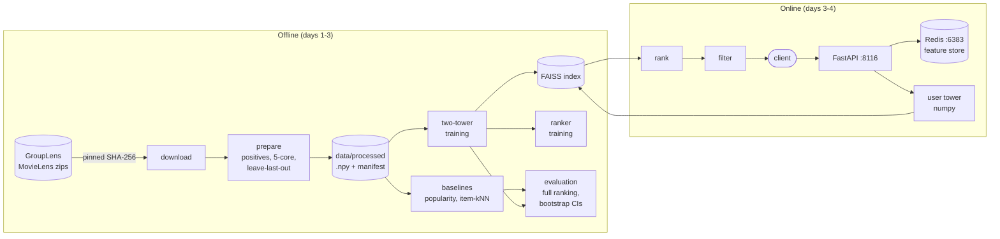

# Signal

A movie recommender with online serving, built in five days on MovieLens: baselines (popularity, item-kNN), a
two-tower retriever trained with in-batch negatives, FAISS retrieval, a ranking stage, a Redis feature store for
online features, and a FastAPI service (retrieve → rank → filter) with a latency benchmark and an A/B test simulator.

**Status: day 2 of 5** (day 1: design, data pipeline, evaluation protocol, baselines; day 2: the two-tower retriever,
chosen and reported by the same protocol, and what the split's time leak is worth to it). [DESIGN.md](DESIGN.md) is
the specification for all five days. CI runs on every push (see "Day 1 notes").

## Architecture



Built so far: everything on the offline side except the FAISS index and the ranker (day 3).

## How to run

```bash
make venv                                  # Python 3.11 virtualenv with the package and dev tools
make check                                 # ruff, ruff format --check, mypy --strict, pytest
.venv/bin/signalrec download ml-1m         # from GroupLens, checked against its pinned SHA-256
.venv/bin/signalrec prepare ml-1m          # data/processed/ml-1m/
.venv/bin/signalrec baselines ml-1m        # results/ml-1m/baselines.json and a table
.venv/bin/signalrec leakage ml-1m          # results/ml-1m/leakage.json
.venv/bin/signalrec recommend ml-1m --user 1   # one user's recent likes and item-kNN's top 10, by title
.venv/bin/signalrec twotower ml-1m         # results/ml-1m/twotower.json (about 13 minutes here)
.venv/bin/signalrec leakage-twotower ml-1m # results/ml-1m/leakage-twotower.json (needs twotower.json first)
.venv/bin/python scripts/recency_ablation.py ml-1m --out results/ml-1m/recency-ablation.json
```

PyTorch runs on the CPU (`pip install torch` pulls in the right wheel on a Mac; on Linux, install the CPU-only wheel
from `https://download.pytorch.org/whl/cpu` first, as CI does).

For example, ml-1m user 1's last five likes are Disney and Pixar animation (The Hunchback of Notre Dame, Antz, A
Bug's Life, Hercules, Mulan); item-kNN (k=3) puts Sleeping Beauty and Pinocchio in its top 10 next to broad favourites
such as The Shawshank Redemption; popularity's top 10 has no animation at all. The held-out test movie is Pocahontas,
which neither list contains.

`make data` downloads and prepares both datasets; `make results` regenerates every number in the results below
(the benchmark wants a quiet machine). `ml-latest-small` works the same way as ml-1m. `signalrec synthetic` writes a
**synthetic** dataset in ml-latest-small's file format (`signalrec prepare synthetic`, `signalrec baselines
synthetic`); the tests use it, and no number from it is a claim about real users.

## Data

| Dataset | Ratings | Users | Movies | After the pipeline (users × movies, training positives) |
|---|---|---|---|---|
| ml-latest-small | 100,836 | 610 | 9,742 | 601 × 1,955, 40,025 |
| ml-1m | 1,000,209 | 6,040 | 3,883 listed, 3,706 rated | 6,034 × 3,125, 562,308 |

Counts after the pipeline from `signalrec prepare <dataset>` (also pinned by a test). **No MovieLens data is in this
repository**: the ml-1m licence forbids redistribution without permission, so the code downloads it from GroupLens,
and CI does the same for ml-latest-small without uploading anything derived from it. Research use only; GroupLens
doesn't endorse this project. Citation: F. Maxwell Harper and Joseph A. Konstan. 2015. The MovieLens Datasets:
History and Context. ACM TiiS 5, 4: 19:1-19:19. <https://doi.org/10.1145/2827872>

The pipeline (DESIGN.md, "From ratings to implicit feedback"): a rating of 4 or more is a positive; users and movies
with fewer than 5 positives are dropped until both bounds hold at once; each user's last positive by (time, movie id)
is the test item and the one before it the validation item.

## Evaluation protocol

Every model ranks **every** movie for every user (no sampled negatives), with the user's history removed. Choices are
made on the validation item with the training positives as history; test numbers come from the model refit on
training + validation. With one held-out item, Recall@K is the share of users whose item is in their top K and
NDCG@K averages `1/log2(rank+1)` inside the cut-off. Ranks are exact counts with ties broken by movie index, so they
don't depend on a sort. Intervals are 95% percentile bootstraps over users (1,000 resamples, seed 20261107); model
differences use a paired bootstrap on the same resampled users.

## Results (day 1)

Measured on 2026-11-07 (Apple M3, macOS 26.6, Python 3.11.12, NumPy 2.4.6, SciPy 1.17.1).

**ml-1m**, test, 6,034 users (`signalrec baselines ml-1m`, `results/ml-1m/baselines.json`):

| Model | Recall@10 | NDCG@10 | Recall@50 | NDCG@50 | Coverage@10 |
|---|---|---|---|---|---|
| popularity | 0.0389 [0.0343, 0.0441] | 0.0193 [0.0166, 0.0221] | 0.1294 [0.1210, 0.1387] | 0.0385 [0.0355, 0.0417] | 0.037 |
| item-kNN (k=3, shrink=10) | 0.0630 [0.0568, 0.0689] | 0.0314 [0.0280, 0.0349] | 0.1845 [0.1743, 0.1946] | 0.0581 [0.0544, 0.0618] | 0.213 |

Item-kNN minus popularity (paired): NDCG@10 +0.0122 [0.0085, 0.0157], Recall@50 +0.0550 [0.0444, 0.0653].

**ml-latest-small**, test, 601 users (`signalrec baselines ml-latest-small`, `results/ml-latest-small/baselines.json`):

| Model | Recall@10 | NDCG@10 | Recall@50 | NDCG@50 | Coverage@10 |
|---|---|---|---|---|---|
| popularity | 0.0449 [0.0283, 0.0616] | 0.0235 [0.0146, 0.0328] | 0.1414 [0.1131, 0.1697] | 0.0441 [0.0339, 0.0542] | 0.031 |
| item-kNN (k=2, shrink=0) | 0.0765 [0.0549, 0.0982] | 0.0360 [0.0252, 0.0470] | 0.1780 [0.1464, 0.2063] | 0.0584 [0.0462, 0.0703] | 0.384 |

Item-kNN minus popularity (paired): NDCG@10 +0.0125 [-0.0003, 0.0256]. On 601 users the interval includes zero:
this dataset can't separate the two baselines at NDCG@10, which is why ml-1m carries the reported results.

What the numbers say:

- **NDCG@10 is flat across small neighbourhoods; Recall@50 wants more.** Validation NDCG@10 on ml-1m peaks at k=3
  (0.0386), with k=10 at 0.0359 and k=100 at 0.0325, so the protocol picks k=3. After the protocol's run I also
  scored k=10 (shrink 0) on test, labelled post hoc (`signalrec baselines ml-1m --grid 10:0 --out
  results/ml-1m/post-hoc-item-knn-k10.json`): NDCG@10 0.0322 [0.0286, 0.0355], no worse than k=3's 0.0314, and
  Recall@50 0.2158 against k=3's 0.1845. So validation's preference for k=3 at NDCG@10 didn't carry over to test
  (the gap is inside the intervals), while the Recall@50 cost of tuning for NDCG@10 is real. The reported number
  stays k=3's: switching to k=10 after seeing test would be tuning on test. The JSON now says how firm each choice
  is: for every grid row, the paired validation interval of (chosen - row) NDCG@10. On ml-1m, k=3 is
  indistinguishable from 7 of the other 29 rows (k=2 to 5) and only just ahead of k=10 ([0.0000, 0.0054]); on
  ml-latest-small it is indistinguishable from 19 of 29, so that dataset's choice is noise.
- **Popularity is a strong floor and a narrow one.** Its top 10 lists cover 3.7% of the catalogue; item-kNN's cover
  21%. A day-2 model has to beat item-kNN's 0.0314, not popularity's 0.0193.
- **These are low absolute numbers by design**: one held-out item ranked against about 3,000 movies, with no sampled
  negatives. Papers that rank against 100 sampled negatives report much larger numbers; they aren't comparable.

The grid (`experiment.DEFAULT_GRID`) is k ∈ {1, 2, 3, 5, 10, 25, 50, 100, 200, 400} × shrink ∈ {0, 10, 50}; it starts
at 1 because the first runs, with the grid starting at 10, then 5, then 2, chose its smallest value each time. Every
validation row is in the JSON. The baselines JSON also records fit and evaluation times from runs taken while other
jobs loaded the machine; use the benchmark above instead.

### How much does the split leak? (`signalrec leakage <dataset>`, `results/<dataset>/leakage.json`)

A per-user split lets a model train on positives that happened after a user's test item. On ml-1m the leak is
large in exposure: for the average user, **44.2%** of all training positives are later than their test item (52% on
ml-latest-small), and 99.98% of users have at least one. What is it worth? Popularity is the model most exposed, so
`signalrec leakage` ranks each test item under popularity counted only from positives strictly *before* that user's
test time and compares it, paired, with the usual popularity:

| ml-1m, test, 6,034 users | Global popularity (leaky) | As of each test time | Difference [95% CI] |
|---|---|---|---|
| Recall@10 | 0.0389 | 0.0384 | +0.0005 [-0.0013, +0.0025] |
| NDCG@10 | 0.0193 | 0.0190 | +0.0002 [-0.0006, +0.0010] |
| Recall@50 | 0.1294 | 0.1251 | +0.0043 [+0.0013, +0.0073] |
| NDCG@50 | 0.0385 | 0.0375 | +0.0010 [+0.0003, +0.0018] |

So at the top of the list the leak is worth nothing measurable to popularity, and deeper in the list it is real but
small (3% of Recall@50). The two counts differ in one more way: the as-of count includes other users' earlier test
items, which the global count never sees. On ml-latest-small every difference's interval includes zero.

### Pipeline cost (`python scripts/bench_pipeline.py ml-1m --repeats 5 --out results/ml-1m/bench.json`)

ml-1m, median of 5 runs, load average 2.1-2.3, no sleep during any run (each run's load and sleep are in the JSON).
The power source wasn't recorded: the Mac was on AC at 15:52 and on battery by 17:21 (Low Power Mode off).

| Stage | Median | Min |
|---|---|---|
| parse (`movielens.load`, 1,000,209 ratings) | 1.423 s | 1.422 s |
| prepare (positives, 5-core, split) | 0.243 s | 0.240 s |
| item-kNN fit (k=3, shrink=10, block 512) | 0.664 s | 0.662 s |
| item-kNN evaluate (6,034 users × 3,125 movies, full ranking) | 0.217 s | 0.215 s |
| popularity evaluate (same) | 0.476 s | 0.475 s |

The similarity build's peak traced memory by column block (`tracemalloc`, which sees NumPy's arrays): 27.0 MiB at
128 columns, 90.9 MiB at 512, 297.4 MiB at 2,048 and 451.5 MiB with all 3,125 movies in one block: linear in the
block, as DESIGN.md says, so a catalogue too big for one block still fits by shrinking it. Popularity evaluates more
slowly than item-kNN because of `top_k`'s stable sort (35.4 ms against 13.2 ms per 512 users, timed separately):
item-kNN's scores are mostly equal zeros (74 distinct values in user 0's row against popularity's 682), which the
sort runs through quickly. Neither matters at this size.

## Results (day 2): the two-tower retriever

Measured on 2026-11-08 (Apple M3, macOS 26.6, Python 3.11.12, PyTorch 2.15.0 on the CPU with 4 threads, NumPy
2.4.6), on AC power, with a review agent running alongside, so the recorded seconds are not benchmarks.

**ml-1m**, test, 6,034 users (`signalrec twotower ml-1m`, `results/ml-1m/twotower.json`; the baseline rows are the
same models as day 1's, refit in the same run):

| Model | Recall@10 | NDCG@10 | Recall@50 | NDCG@50 | Coverage@10 |
|---|---|---|---|---|---|
| popularity | 0.0389 [0.0343, 0.0441] | 0.0193 [0.0166, 0.0221] | 0.1294 [0.1210, 0.1387] | 0.0385 [0.0355, 0.0417] | 0.037 |
| item-kNN (k=3, shrink=10) | 0.0630 [0.0568, 0.0689] | 0.0314 [0.0280, 0.0349] | 0.1845 [0.1743, 0.1946] | 0.0581 [0.0544, 0.0618] | 0.213 |
| two-tower (τ=0.1, logQ on, 17 epochs, seed 0) | 0.1361 [0.1279, 0.1448] | 0.0713 [0.0663, 0.0766] | 0.3533 [0.3421, 0.3651] | 0.1186 [0.1134, 0.1238] | 0.626 |

Two-tower minus item-kNN (paired, test): NDCG@10 +0.0398 [0.0345, 0.0453], Recall@50 +0.1689 [0.1551, 0.1836].
The rule DESIGN.md set before any training, a paired *validation* interval above zero, holds: +0.0414 [+0.0352,
+0.0469]. Seeds 0, 1 and 2 of the same configuration score NDCG@10 0.0713, 0.0706 and 0.0693 on test: the spread
over seeds (0.002) is a twentieth of the gap to item-kNN.

**ml-latest-small**, test, 601 users (`signalrec twotower ml-latest-small`): two-tower (τ=0.1, logQ on, 10 epochs)
NDCG@10 0.0523 [0.0392, 0.0674] against item-kNN's 0.0360; paired +0.0163 [+0.0009, +0.0319], just above zero.
Seeds give 0.0523, 0.0455 and 0.0526: on 601 users the seed spread is about half the gap.

What the validation grid says (every configuration's learning curve and every candidate's paired interval are in the
JSON):

| ml-1m validation | τ=0.05 | τ=0.1 | τ=0.2 |
|---|---|---|---|
| logQ on: best NDCG@10 (epoch) | 0.0777 (5) | **0.0799 (17)** | 0.0717 (12) |
| logQ off: best NDCG@10 (epoch) | 0.0440 (11) | 0.0496 (11) | 0.0436 (15) |
| logQ on: coverage@10 at that epoch | 0.71 | 0.62 | 0.48 |
| logQ off: coverage@10 at that epoch | 1.00 | 1.00 | 0.99 |

- **logQ correction matters more than anything else in the grid.** Without it, every temperature loses about 0.03
  NDCG@10 (40%; still above item-kNN's 0.0386 on validation), and the top-10 lists cover the entire catalogue:
  in-batch negatives are popularity-weighted, so the uncorrected model learns to push popular movies down, and
  recommends the long tail to everyone.
- **The choice is firm in configuration and soft in epochs.** τ=0.05 with logQ is indistinguishable from the chosen
  τ=0.1 (paired interval [-0.0025, +0.0072]); everything without logQ, and τ=0.2, is clearly worse. 27 of the other
  119 (configuration, epoch) candidates are indistinguishable from the chosen one, all of them logQ-on at τ 0.05 or
  0.1 from epoch 5 on: past epoch 5 the curve is flat within noise.

### Where does the lead come from? (`python scripts/recency_ablation.py ml-1m`, `results/ml-1m/recency-ablation.json`)

The user tower averages the last 50 positives; item-kNN sums over all of them. Post hoc, on validation only (the
test items are never read), item-kNN was scored from each user's last *n* positives (similarities still from all the
data) and the reported two-tower configuration was retrained with *n*-item histories (same τ, epochs and seed):

| History | item-kNN NDCG@10 | two-tower NDCG@10 | two-tower Recall@50 |
|---|---|---|---|
| last 1 | 0.0411 | 0.1126 | 0.3941 |
| last 5 | **0.0599** | **0.1233** | **0.4899** |
| last 10 | 0.0554 | 0.1090 | 0.4652 |
| last 20 | 0.0481 | 0.0889 | 0.4211 |
| last 50 (two-tower as reported) | 0.0402 | 0.0799 | 0.3870 |
| last 200 | 0.0386 | 0.0744 | 0.3742 |
| all (item-kNN as reported) | 0.0386 | - | - |

Recency is worth a lot to both: scoring item-kNN from the last 5 positives alone lifts it from 0.0386 to 0.0599
(paired +0.0213 [+0.0171, +0.0255]), half of its gap to the reported two-tower model. But at *equal* history length
the two-tower model still leads by about two to one (0.1233 against 0.0599 at five), so the lead is not only recency.
And the reported model's 50-item history, a fixed setting from DESIGN.md, is far from the best: five items score
0.1233 against 0.0799 on validation. It wasn't switched today, because this is one seed of a post-hoc look; day 3 makes
the history length a grid dimension so the protocol chooses it. (724 of 6,034 users have more than 200 training
positives, up to 1,415; the two-tower model wasn't run on whole histories because a batch of 1,024 such histories
would gather hundreds of MB per step.)

### What is the leak worth to the two-tower model? (`signalrec leakage-twotower <dataset>`)

Day 1 found the split's calendar-time leak worth almost nothing to popularity. A learned model could use it more. A
model can't be retrained per user, so users are cut into 10 buckets of about 603 by test time, and for each bucket the
reported configuration (same τ, epochs, seed) is retrained on the training + validation positives before the bucket's
earliest test time, then compared paired with the reported model on test (`results/<dataset>/leakage-twotower.json`).

The first version of this check halved the model, and the reason was not the leak. The cut drops everything after
it, including each bucket's own users' positives between the cut and their test item, which are their own past. Even
the last bucket, trained on 97% of the examples, fell from 0.0335 to 0.0186. So each bucket also trains a second model
that keeps its own users' training and validation positives whatever their time:

| ml-1m, test NDCG@10 (6,034 users) | Value | Leaky minus it [95% CI] |
|---|---|---|
| reported model (trained on all training + validation) | 0.0713 | |
| as of each bucket's cut, everything after it dropped | 0.0354 | +0.0359 [+0.0310, +0.0412] |
| as of the cut, the bucket's own histories kept | 0.0712 | +0.0001 [-0.0048, +0.0054] |

So the two estimates bracket the leak's worth, roughly: between nothing measurable and half the model. Review round 3
showed that the second one leaks too, and not a little: it keeps a bucket-mate's positives later than a user's own
test item, and in ml-1m's first bucket only 468 of its 43,520 training examples are from before the cut. What the
pair can't say how much of the first estimate's drop was the leak and how much was users' own recent past. A
check on the code: the last bucket's own-histories model trains on exactly the reported model's 562,308 examples and scores
exactly its 0.0335.

Smaller buckets narrow both errors. With 20 buckets of about 302 users (`signalrec leakage-twotower ml-1m --buckets
20 --out results/ml-1m/leakage-twotower-20-buckets.json`, 19:27-19:45), the strict model scores 0.0368 (+0.0345
[+0.0296, +0.0396]) and the own-histories model 0.0692 (+0.0020 [-0.0028, +0.0069]); at Recall@50 the own-histories
difference, +0.0220 [+0.0109, +0.0336], now excludes zero (10 buckets: +0.0071 [-0.0035, +0.0177]). So as the
within-bucket leak shrinks, the lower end of the bracket rises: the leak is worth something to the two-tower model
deeper in the list, as it was to popularity (day 1: Recall@50 +0.0043), and little at the top. On **ml-latest-small** (601 users over 22 years, 60 per bucket) a gap remains even with own
histories kept: NDCG@10 0.0523 against 0.0308, +0.0215 [+0.0094, +0.0356]. With so few users per bucket, an early
bucket's model learns from very little, so that gap mixes the leak with plain data volume; this run can't separate
them.

## Day 1 notes

Facts about the real files that the strict parsers found (DESIGN.md said nothing about them before):

- ml-latest-small uses **CRLF** line endings in both files; GroupLens's README doesn't say so. ml-1m uses LF.
- ml-1m's `movies.dat` is **Latin-1**, not UTF-8: 62 bytes above 0x7f, each alone (0xe9 for "é").
- **11 titles** in ml-latest-small end in a space ("96 Minutes (2011) "); titles are stripped.
- The real files parse to GroupLens's published counts (a test, run in CI on ml-latest-small).

CI: the workflow has two jobs (lint, types and tests; then the whole pipeline on the real ml-latest-small, with the
baselines and the leakage compared with the committed results as whole documents). The first run on GitHub
(Ubuntu 24.04, x86-64, Python 3.11.18) passed both jobs: 212 tests passed and 4 skipped without data, then the real
ml-latest-small matched the committed baselines and leakage results with 0 differences on another CPU architecture.
Before the repository existed, every step was rehearsed in a fresh clone with a fresh virtualenv on macOS.

## Review of day 1

One review agent read the code at `914dcdf` (16:20-16:34, about 14 minutes, its own worktree, a correctness brief:
find where the code disagrees with DESIGN.md or itself, prove each defect with a failing test). Its tests are in
`tests/review_d1/`, each file's docstrings stating the defect; all pass now.

| Finding | Fix |
|---|---|
| **Ties decided by rounding.** 3/√27 and 1/√3 are equal but differ in a double's last bit, so item-kNN kept the wrong neighbour; float32 score sums put a tied item 2nd. | Similarities as `sqrt(co²/(n_i n_j))` with no shrink, rounded to 2^-32 and kept as integers; scores are exact integer sums (`6c8847f`). The second case is only bounded: sums of *different* square roots equal as reals can still differ by a unit, and the test pins that. |
| An unclosed quote in movies.csv swallowed the next line (a movie vanished silently); a `csv.Error` escaped with no file or line. | One CSV record per line; errors name the line (`e6766e5`). |
| ml-1m `Foo (1999):::Comedy` read as the genre `:Comedy`. | The last `::` ends the title; a title holding `::` is refused (`e6766e5`). |
| A genre with a tab saved fine and broke `load`. | Control characters refused by the parsers and by `save` (`e6766e5`, `005a9e5`). |
| `load` checked only the files the manifest listed. | The manifest must list exactly the expected files (`005a9e5`). |
| Replacing a processed directory deleted the old one first. | Old renamed aside, put back on failure (`005a9e5`; the reviewer's injection failed the put-back too, so its setup was narrowed, not its assertion). |
| A bad `--grid`, an offline download and a corrupt manifest ended in tracebacks. | argparse validates `--grid`; `OSError` from a fetch and a bad manifest are one-line errors (`247cf6a`, `005a9e5`). |

It also listed about 30 mutants no test killed. The worst: **swapping the validation items for the test items in
tuning survived every test**, so the protocol's central rule was untested. Each listed survivor now fails a test
(`d10cb54`, `03223f5`; re-applied from a copy and restored byte for byte), except `extract`'s `is_dir()` check,
which was unreachable and is removed.

A second round (one agent at `f2c825f`, 16:46-16:58, asked "what did each round-1 fix break?"; tests in
`tests/review_d1r2/`) found 8 more defects, most of them in round 1's fixes:

| Finding | Fix |
|---|---|
| `shrink < 0` let NaN through; `rint(NaN · 2^32)` as int64 is INT64_MIN, so every similarity was dropped. | Shrink must be finite and ≥ 0, also checked when an `ItemKNN` is built (`d5ed2b5`). |
| Round 1 mapped `OSError` to `DownloadError`, but `http.client.IncompleteRead` isn't an `OSError`. | Both mapped (`d5ed2b5`). |
| Round 1's replacement left an empty `.<name>-old-*` directory when the first rename failed. | Removed; a failed delete of the old copy after the swap no longer fails the save (`86f3e56`). |
| `"format": true` passed the version check (`True == 1`). | Must be an `int` (`86f3e56`). |
| A manifest without params, counts or sources was a `KeyError`; another dataset's directory was evaluated and mislabelled; counts weren't checked. | Fields checked, counts must equal the arrays', `load(directory, dataset)` (`86f3e56`). |
| `recommend --neighbours 0`, `--shrink -1` tracebacks; `--shrink nan`, `--k -1`, `--k 0` exited 0 with wrong lists. | argparse types shared with `--grid` (`7b2f7f2`). |

Its 13 surviving mutants (including the leakage report's two columns swapped, which would flip the sign of the
reported leak) each fail a test now (`d5ed2b5`, `86f3e56`, `7b2f7f2`, `c5df773`). It also pointed out that the
brute-force item-kNN test had come to mirror the implementation's formula, so a second test checks the plain float
definition independently (`694c87b`).

A third round (one agent at `c5df773`, 17:04-17:08, on round 2's fixes; `tests/review_d1r3/`) found 3: manifest
counts of the wrong type passed (`60.0 == 60`, `False == 0`; counts must be ints); `prepare` over a symlink or a
file at the target still ended in a traceback (now refused up front); and `baselines` read the manifest twice, so a
concurrent `prepare` could put new parameters beside old metrics (`load` now attaches the manifest it checked).
All fixed in `2e9f886`, its 3 survivors killed in `296bbf0`. A fourth round (17:14-17:16) looked at round 3's fixes
and at the leakage comparison I had added to CI an hour earlier: round 3's fixes held, the new comparison didn't
(NaN passed, intervals unchecked, extra keys ignored, missing keys a `KeyError`, `601.0` passing as a count).
`compare_results.py` now compares whole documents recursively instead of hand-picked fields (`e4b4fb0`).
Findings per round: 11, 8, 3, 5; every round's were mostly in code written since the round before.

My own checks found what the reviewer didn't look for: the real files' CRLF and Latin-1 (above), the grid choosing
its own edge three times, and two claims of mine that measurement contradicted: the median ml-1m history (56
training positives, not the 70 I first wrote; caught before it was committed) and the reason popularity evaluates
more slowly (the sort's work on varied scores, not ties; corrected in `f2c825f`).

## Review of day 2

Two review rounds, each one agent in its own worktree with a correctness brief, each finding a failing test (now
passing) in `tests/review_d2/` and `tests/review_d2r2/`, plus a list of mutants that no test killed.

**Round 1** (at `fd4b0f4`, about 9 minutes) found no leak, loss or selection bug, and 7 defects at the edges, fixed in
`9899a33`: `--seeds` took 2^64, which `torch.manual_seed` refuses after the whole grid had trained; `--grid` took a
repeated configuration; `run` didn't check the item-kNN grid (an empty one failed after all the training) or later
seeds; a temperature of 1e-39 trained on NaN losses; DESIGN asked for every candidate's paired interval and only each
configuration's best epoch had one; and DESIGN said every training positive is an example, which isn't true of each
user's first (no history), so DESIGN changed. Its 14 surviving mutants mattered more: **a target leaking into its own
training history**, the logQ flag inverted, the temperature or the accidental-hit mask ignored in training, genres
ignored, the user tower reading the item table, scoring without each user's last positive. Every other test
recomputed results through the same `train` and `embed`, so it couldn't see inside them.
`tests/test_twotower_internals.py` now watches from outside (spies on what each batch feeds the loss; both towers
recomputed by hand), and all 18 listed mutants fail a test (`01f22e2`; applied from a copy, restored, compared byte
for byte).

**Round 2** (at `01f22e2`, about 14 minutes) was asked what round 1's fixes broke, and reviewed the two pieces no round
had seen (`leakage_twotower.py`, `scripts/recency_ablation.py`). 5 defects, fixed in `7faa1a9` and `b9d7045`:

| Finding | Fix |
|---|---|
| Round 1's temperature bound (1/τ a finite float32) was too loose: 3e-39 is a denormal and still trained on NaN. | A floor, τ ≥ 1e-3, for `--grid` too. |
| `temperature=True` and `lr=True` passed as 1.0, so a results file saying `"temperature": true` became a configuration. | Must be an int or float, not a bool. |
| `ItemKNN` took `k=5.0`; `run` failed with a `TypeError` after the whole two-tower grid. | k and block must be integers. |
| `leakage-twotower` filled fixed settings missing from the results file with today's defaults, and took a file produced from other prepared data. | Every fixed setting required; the file's params, counts and sources must equal the manifest's. |
| The recency ablation's reference row was hard-coded as "last 50". | The reported length is always a row and the reference; `main()` tested. |

Its most useful note was a hunch, which the code confirmed: the as-of model trained on other users' *test* positives
before the cut, which the leaky model never sees, so "the as-of model knows less" wasn't true and the docstring's
bound didn't hold. The as-of model now trains on training + validation positives before the cut only, a subset of the
leaky model's data. 24 surviving mutants, including **the ablation reading the test items** (`main()` had no test);
each now fails a test (`7faa1a9`, `b9d7045`).

**Round 3** (at `eca3bd9`, about 10 minutes) checked round 2's fixes and the second as-of model. 5 defects: an
integer too large for a float raised `OverflowError` from `Config.check` (and a traceback from `leakage-twotower`);
round 2's type rule refused NumPy floats; the learning rate had no bound (`lr=1e30` trained on NaN, now at most 1);
the recency ablation coerced the results file's item-kNN `k` (`true` ran as 1, `2.7` as 2). And its hunch changed a
conclusion: the own-histories model leaks too, and not a little (above), so "the leak is worth nothing" became a
bracket. 17 surviving mutants, all now failing a test. Findings per round: 7, 5, 5, each mostly in code written
since the round before.

## Design decisions

- **Implicit feedback at rating ≥ 4.** The product wants movies a user will like, not merely watch. Low ratings are
  dropped from the training signal; the day-4 serving filter still removes every rated movie.
- **Leave-last-out by time, with movie id breaking ties.** It mirrors "what will this user like next" and makes the
  split a pure function of the data (ml-1m users often rated dozens of movies in one second). Known cost: a per-user
  split leaks calendar time across users (DESIGN.md, "Known leakage").
- **Full ranking, exact ranks.** Sampled metrics can reorder models; counting ranks (rather than sorting) makes ties
  explicit and the result independent of the sort.
- **Validation for choices, test for numbers, intervals on everything.** The test set is touched once per model.
- **Byte-deterministic processed data with a hashed manifest.** Re-running gives the same bytes; loading refuses a
  file that changed.
- **Pinned downloads and member-name extraction.** A swapped or truncated archive fails the hash; a hostile archive
  can't write outside its directory because only the expected member names are ever read.
- **A user tower over the history, no user id** (day 2). Any history works, including one that changed a minute ago
  or belongs to a user the model never saw; that is what lets day 3 serve fresh histories from Redis.
- **In-batch negatives with logQ correction** (day 2). One matrix product per batch, no sampler; logQ undoes the
  popularity bias that in-batch sampling adds (measured: worth +0.030 validation NDCG@10 at τ=0.1).
- **Epochs chosen on validation, like every other choice** (day 2). Validation is scored after every epoch, so the
  epoch count is one more hyperparameter with a paired interval, and the test run retrains for exactly that many.
- **Evaluation through exported embeddings** (day 2). The towers become two NumPy matrices and go through the same
  exact-rank code as the baselines, which is also what serving will use: no PyTorch on the request path.

## Limitations

- The per-user split's cross-user time leakage is measured, not removed: for popularity (day 1, worth almost nothing)
  and for the two-tower model (day 2, bracketed between nothing measurable and half the model's NDCG@10; above).
- The two-tower choice is the best of 120 validation candidates and item-kNN's the best of 30, on the same
  validation users that are then used to compare them, so the validation comparison slightly favours the larger
  search (review round 1 raised this). The test comparison is not affected: test is touched once per model.
- In-batch negatives include the same user's other positives when two of their examples share a batch (only the same
  *movie* is masked). That is the standard formulation and DESIGN's; it slightly penalises a user's own taste.
- Nothing makes training identical across machines (float reductions can differ by CPU and thread count; not
  measured, since only one machine was available), so CI runs the two-tower commands on real data without comparing
  their numbers. On one machine a seed gives the same weights (a test).
- Item-kNN's similarity is cosine on binary likes; no recency weighting, which the k results suggest would help.
- ml-latest-small is too small to separate the baselines at NDCG@10; it is the CI dataset, not the results dataset.
- Similarities are kept to 2^-32, so a shrink in the billions leaves them a few grid units apart (ties take over),
  and above about 2^33 ≈ 8.6e9 times a pair's co-count rounds it to zero (checked: a co-count-1 pair survives a shrink
  of 8e9 and vanishes at 9e9). Nothing refuses such a shrink; the useful range is 0 to about 100.

## Layout

```
src/signalrec/
  download.py     pinned download and extraction
  movielens.py    strict parsers for both formats
  prepare.py      positives, k-core, split, indexing, the on-disk format
  evaluate.py     exact ranks, Recall/NDCG/coverage, bootstrap intervals
  baselines.py    popularity, item-kNN
  experiment.py   the protocol: tune on validation, report on test
  twotower.py     the two-tower model: sequences, histories, towers, loss, training, exported embeddings
  experiment_twotower.py   the two-tower model by the same protocol
  leakage.py      the split's calendar-time leakage, measured
  leakage_twotower.py      ... and what it is worth to the two-tower model
  recommend.py    one user's recommendations by title
  synthetic.py    a synthetic dataset for tests and CI
  cli.py          signalrec download | synthetic | prepare | baselines | leakage | recommend | twotower |
                  leakage-twotower
scripts/compare_results.py   CI's check against the committed results
scripts/bench_pipeline.py    stage timings and the similarity build's memory by block size
scripts/recency_ablation.py  validation-only: history length for item-kNN and the two-tower model
results/<dataset>/{baselines,leakage,twotower,leakage-twotower}.json, results/ml-1m/recency-ablation.json
```

## License

MIT for the code. MovieLens is not in this repository: it is downloaded by script, under GroupLens's own terms.
